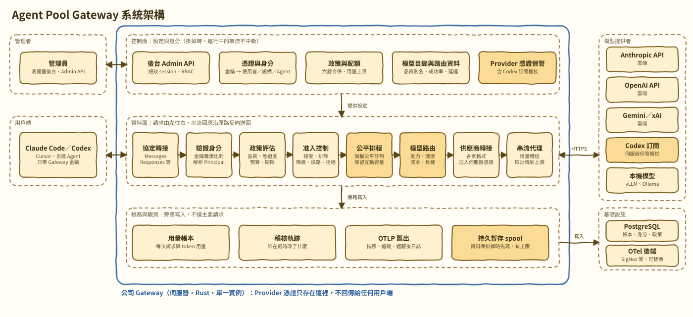

# 架構

## 目標

每個人／每台設備／每個 Agent 拿一把可撤銷的閘道金鑰，把公司核准的官方 API 容量集中調度，
依政策決定「誰先跑、用哪個模型、花多少」，並留下完整的用量與稽核軌跡——**Provider 憑證永不外流**。

## 架構圖



PDF 版：[architecture-diagram.pdf](architecture-diagram.pdf)。圖只畫目前已有的元件；改元件時一起改圖。

## 三個 Plane

邊界要一直保持清楚，這是整份架構最重要的約束。

### 資料面（Data Plane）

真正的推論流量走這裡。

`Protocol Adapter → 認證 → Principal 解析 → 政策評估 → Admission Control → Scheduler →
速率／併發控制 → Model Router → Provider Adapter → Retry／Fallback → 串流 → 取消`

### 控制面（Control Plane）

User／Device／Client／Agent／身分／憑證／API Key／Access Token／模型註冊表／Provider／
政策／配額／排程設定／Admin UI／RBAC／稽核。

**控制面掛掉時，已經進行中的推論串流不得跟著中斷。**

### 可觀測性與帳務面（Observability / Accounting Plane）

帳務：請求帳本、token 用量、Provider 用量、成本、預算、配額。
可觀測性：metrics、traces、結構化 log、Provider 健康、佇列健康、排程健康、告警、SRE 儀表板。

閘道對可觀測性後端**只依賴 OTLP**，不綁 Grafana／Prometheus／Tempo／SigNoz／Datadog。
開發環境預設給 SigNoz 的 compose（因為部署簡單），閘道本體只認 OTLP。

## 請求路徑

```text
Client（Claude Code / Codex / VS Code / Cursor / 自建 Agent / 自動化 Agent）
  ↓  閘道金鑰
Protocol Adapter（Anthropic Messages / OpenAI Responses / Chat Completions）
  ↓
Canonical Request
  ↓
Principal（誰／哪台設備／哪個 Client／哪個 Agent／哪把金鑰）
  ↓
Policy（quality／workload／urgency／budget／deadline，六層合併）
  ↓
Admission Control（accept / queue / downgrade / reroute / reject）
  ↓
Scheduler（WHEN：加權公平佇列 ＋ aging ＋ 保留容量）
  ↓
Router（WHERE：模型註冊表 ＋ 能力 ＋ 健康 ＋ 成本 ＋ 負載）
  ↓
Provider Adapter
  ↓
Provider（Anthropic / OpenAI / Gemini / xAI / Local vLLM・Ollama）
```

回應反向走同一條路，串流是**增量轉送**：

```text
Provider SSE → Provider Adapter → Canonical Stream Event → Protocol Adapter → Client SSE
```

Same-dialect forwarding keeps a short-lived native wire sidecar so request,
response, and SSE bytes are not re-encoded. The canonical view is still built
once at ingress and enriched with identity, policy, quota, and trace context.
Protocol adapters and provider adapters depend only on canonical types, never
on each other. Each provider adapter selects its native operation, path,
authentication mode, and header allowlist from a vendor-neutral operation;
both client routes then use one common HTTP transport. The core dispatcher
chooses native or canonical payloads. Each provider profile declares a target
dialect, so provider selection is not inferred from the client endpoint. The
canonical contract includes neutral tool choice, reasoning, and
structured-output fields; malformed, conflicting, or vendor-only shapes stay
source-scoped and cannot be silently translated.

Content-bearing canonical values are in-memory request data. They are not
serializable, their debug output is redacted, and they never enter the ledger,
logs, traces, or spool by default.

旁路（不擋主路徑）：

```text
Request ├── 用量帳本（PostgreSQL）
        ├── OpenTelemetry
        ├── 稽核
        └── Admin
```

## 排隊會打爛 prompt cache 的經濟學

**這條寫在這裡，因為它跨越 Scheduler、Quota 與帳務三個地方，不屬於任何單一段落。**

上游的 prompt cache 有 TTL。請求在佇列裡等超過 TTL，下一次上游呼叫就是 100% cache miss。

**沒有錯誤、沒有告警，只有帳單變大**——而且它打在本專案存在的理由（控成本）上：
排程器每提升一分公平性，就等比例增加一分成本。

所以：

- 排程決策要看得到「這個請求的 cache 還有多久過期」，不能只看優先權與等待時間。
- Metric **必須分開記 `cache_read` 與 `cache_write`**，否則這個代價量不出來。
- 同一個 session 的請求盡量落在同一把 Provider 憑證上（憑證分散可能讓 cache 分散）。
  **憑證與 cache 範圍的關係我未查證**，動工前要拿官方文件釘死。

（實測參考：本專案自己的 token 帳本顯示 94.7% 的 token 是 cache_read。
cache 失效不是小數字，見 `docs/task-ledger.md`。）

## 五個概念不准混在一起

| 問題 | 由誰回答 |
| --- | --- |
| WHEN（誰先跑） | Scheduler |
| WHERE（送去哪） | Router |
| HOW GOOD（多好的模型） | Quality Policy |
| HOW MUCH（能花多少） | Budget／Quota |
| WHO（誰發的） | Principal |

**Scheduler 與 Router 不得寫成同一個 module。**

## 元件

1. **資料面**：協定端點、串流代理、金鑰驗證、模型授權、速率限制、預算保留、用量記錄、取消傳遞。
2. **控制面**：人員、設備、Client、Agent、憑證生命週期、政策、Provider、模型目錄、預算週期、稽核查詢。
3. **Provider Adapter**：各家 API 的實際呼叫、能力回報、健康檢查、成本估算。
   **核心閘道自己實作，LiteLLM 不是執行期依賴**（可以讀它的架構學 edge case，不進 `Cargo.toml`）。
4. **PostgreSQL**：身分、政策、金鑰雜湊、預算、用量帳本、設定版本。**精確帳本在這裡，不在 Prometheus。**
5. **OTLP 匯出**：metrics／traces／redacted logs。
6. **Secret 抽象層**：開發環境用 `.env`；正式環境留出介面接 Vault／Cloud Secret Manager／KMS。
   第一版不自己造 secret manager。

## 身分

**Key 只是 Credential，不是 Identity。**

```text
Credential
  ↓ 解析
Principal ├── User
          ├── Device
          ├── Client
          └── Agent
```

人類看的是「Cash → MacBook → Claude Code → Coding Agent」，不是 `aigw_sk_f8a901...`。
階層關係**不寫死在型別裡**；Principal 是一次請求經過憑證解析後得到的邏輯身分。

## 政策解析順序

```text
Global 預設 → User → Device → Client → Agent → Credential → Request hint
```

**Request hint 不得突破上層的 hard constraint。** 合併結果（`EffectivePolicy`）寫進請求記錄，
事後才解釋得出「為什麼這次只給 standard」。

## 公平性

- 限制種類：RPM、估算 TPM、時／日 token、併發請求、日／月成本。
- 維度：User／Device／Client／Agent／Credential／Model／Provider／Workload。
- 上游前做估算 token 的保留，回應後用 provider-reported 用量對帳（兩者分開記，不互相覆寫）。
- 加權公平佇列 ＋ aging，避免背景工作永久 starvation。
- 保留容量保護互動式流量：背景工作塞 1000 個請求也吃不掉互動的保留槽。

## 故障模型

| 故障 | 行為 |
| --- | --- |
| Admin UI 掛掉 | 推論不受影響 |
| OTel 後端掛掉 | 推論不受影響，遙測降級 |
| 儀表板／分析查詢掛掉 | 推論不受影響 |
| PostgreSQL 掛掉 | **已存在的串流不得被 kill**；新請求靠有上限的憑證／政策快取，快取未命中則 fail closed；用量寫進有上限的持久化 spool，恢復後補寫 |
| Provider 掛掉 | 本次不重送；被動健康訊號讓下一請求預先換路，理由持久化 |
| 佇列滿 | 明確拒絕，不無上限堆積 |
| 收到 SIGTERM | 停收新請求、既有串流繼續、`drain_timeout` 到才強制關閉並留下記錄（W19） |

**帳務不得無聲遺失**，spool 必須有上限（不是無上限記憶體佇列）。

## 部署

**第一版：單一閘道實例。**

原因不是懶，是正確性：併發上限與配額計數器在第一版放在行程記憶體裡（規格 §82 明確不做
Redis Cluster），兩個實例就等於所有上限**實際上是兩倍**，而且沒有任何錯誤訊息會告訴你。
W12/W19 已定案維持單實例。要跑多實例就必須先把計數器改成跨實例 durable counters，量測新增的
資料庫成本，再移除啟動時的 advisory lock；這不是目前部署模式。

多實例就緒之後：無狀態閘道實例掛在私有負載平衡器後面。PostgreSQL 與可觀測性後端放私有網段，
Docker port 預設綁 `127.0.0.1`。正式環境變更走版本化設定，Provider 憑證變更需二人核可，
金絲雀推送並保留回滾路徑。

版本可驗證：`/health` 回得出正在跑的版本，不靠口頭保證。
