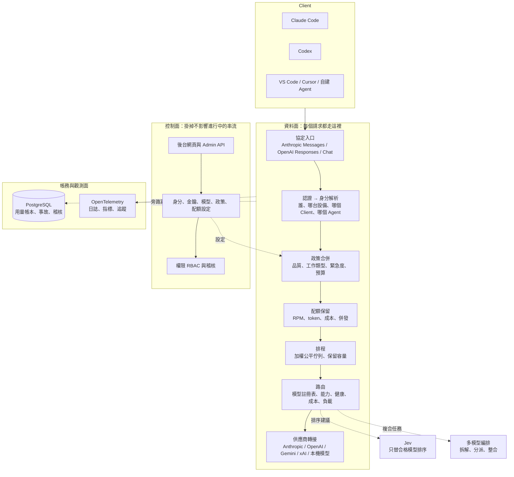

# Gateway 功能與架構總覽

用途：一份看完 Gateway 能做什麼、請求怎麼流、各功能的細節去哪讀、現在做到哪。細節以各模組文件為準，這裡只彙整，不取代。

狀態欄的「已交付」指程式已合進 main 並通過隔離測試，來源是 `loops/README.md`。線上容器是否已啟用每一項，沒有逐項查證；目前線上跑的是 `c8158e5d2089` 恢復版，新版尚未切換。

## 一句話

每個人、每台設備、每個 Agent 拿一把可撤銷的 Gateway 金鑰，Gateway 把公司核准的官方 API 容量集中起來，依政策決定誰先跑、用哪個模型、能花多少，並留下用量與稽核紀錄。上游供應商的金鑰只存在伺服器端，不回給 Client。

## 架構圖

三個面的邊界不能混：資料面處理推論流量；控制面管設定，掛掉時進行中的串流不得中斷；帳務與觀測面只旁路記錄。

五個問題由五個元件各自回答，不寫在同一個模組：誰先跑（排程）、送去哪（路由）、多好的模型（品質政策）、能花多少（預算與配額）、誰發的（身分）。

## 功能清單

| 功能 | 做什麼 | 狀態 | 細節文件 |
| --- | --- | --- | --- |
| Client 接入 | Claude Code、Codex 指向 Gateway 就能用；其他 Client 的支援程度不同 | Claude Code 與 Codex 已支援；Claude Desktop、Cursor、Codex 桌面版未做或未驗 | `client-compatibility.md` |
| Anthropic 與 OpenAI 協定 | 串流增量轉送、取消傳到上游、用量落帳；同協定原樣轉送不重新編碼 | 已交付（W05、W06） | `provider-protocols.md` |
| 跨協定與多供應商 | 用 A 協定的 Client 呼叫 B 家模型；轉不過去的能力明說拒絕；支援 Gemini、xAI、vLLM、Ollama | 已交付（W14–W16） | `provider-protocols.md` |
| 身分與金鑰 | 一把金鑰對應 User、Device、Client、Agent；可簽發、停用、撤銷、輪替（舊金鑰重疊 1 秒到 15 分鐘） | 已交付（W03） | `identity.md` |
| 政策 | 全域、User、Device、Client、Agent、金鑰、請求提示共七層合併；上層硬限制不能被請求提示突破；合併結果存進請求紀錄 | 已交付（W11） | `request-policy.md` |
| 配額與限流 | 每分鐘請求數、估算 token、時日 token、併發數、日月成本；硬限制回 429，軟限制先降品質再延後 | 已交付（W12） | `request-policy.md` |
| 排程與排隊 | 六種工作類型加權公平、等越久權重越高、互動流量有保留容量；佇列滿明確拒絕 | 已交付（W13） | `scheduler.md` |
| 模型註冊與路由 | 換模型是改設定；可指定模型或只要品質等級；依健康、延遲、負載、成本被動換路，不重送同一請求 | 已交付（W10、W17） | `model-registry.md`、`routing.md` |
| 工作分類與選模 | 先判斷工作種類與必要能力，再挑適合且可用的模型；品質等級只是相容別名 | 進行中（S11：S01–S03 完成，S04 驗證中） | `model-task-classification.md` |
| Jev 選模 | 外部服務只替已合格的模型排序；信心低於 0.6、逾時 5 秒或出錯就沿用原指定模型 | 程式完成，實送受本機憑證阻擋（S09） | `jev-local.md` |
| 多模型編排 | 複合任務拆成最多 8 個子任務、最多 3 個並行，各自分派模型，最後整合成一份回應 | 拆解器 shadow 已交付（S13，未開始；dispatcher S14、integrator S15 未開始） | `multi-model-orchestration.md` |
| 用量帳本 | 每筆請求與用量寫進 PostgreSQL；資料庫短暫不可用時寫進有上限的暫存檔，恢復後補寫，不無聲遺失 | 已交付（W04） | `operations.md`、`usage-ledger-queries.sql` |
| 後台網頁與 Admin API | 十二類資源管理、版本檢查防互相覆蓋、角色 admin／operator／viewer、每次異動連同稽核同一交易 | 已交付（W08、W09） | `admin.md`、`admin-web.md` |
| 事故記錄 | 後台記事故狀態、根因、修正、預防與驗證證據，時間線只能追加 | 程式與隔離驗收完成，待正式讀回（S12） | `admin.md` |
| 可觀測性 | JSON 日誌、OpenTelemetry 追蹤與指標、標籤走白名單、不記機密 | 已交付，部分項目移交（W07） | `observability.md` |
| 程序生命週期 | 收到停止訊號後不收新請求、進行中的串流跑完才關；同時只允許一個 Gateway 程序 | 已交付（W19） | `operations.md` |
| 安全邊界 | 不碰訂閱席次、不抽 session token、預設不存 Prompt 與 Response、供應商金鑰只在伺服器端 | 約束，已寫入 | `security-and-compliance.md` |
| 安全部署 | 新版驗收通過才切換，舊版請求完成才下線 | 進行中（本輪 S02） | `operations.md` |

## 失敗時的行為

| 故障 | 結果 |
| --- | --- |
| 後台掛掉、觀測後端掛掉 | 推論不受影響 |
| 資料庫掛掉 | 進行中的串流不中斷；新請求靠有上限的快取，快取沒命中就拒絕；用量先寫暫存檔 |
| 供應商掛掉 | 本次不重送；下一個請求預先換路 |
| 佇列滿 | 明確拒絕，不無限堆積 |
| 停止訊號 | 既有串流繼續，到寬限時間才強制關閉並留紀錄 |

## 刻意的限制

- 目前只能單一實例：併發與配額計數放在程序記憶體，兩個實例等於上限變兩倍。要多實例必須先改成跨實例計數器。
- 排隊會讓上游的 prompt cache 過期，帳單變大卻不報錯，所以快取讀與寫分開記。憑證與快取範圍的關係未查證。
- 沒有上游供應商金鑰時 Gateway 仍可啟動，只是無法呼叫該供應商。
- 擱置：W20 的金鑰、告警、離機備份與自動部署執行器。

## 白話 PDF 圖解

`docs/gateway-guide.pdf` 一份 36 頁：前 2 頁是總圖，之後每個組件 2 頁（第 1 頁位置與流程圖，第 2 頁做什麼、出問題會怎樣、限制），共 17 個組件。由 `scripts/build_guides.py` 讀 `scripts/guides_data.py` 產生；改內容就改後者再重跑。內容來自本檔列的模組文件，狀態以 `loops/README.md` 為準。

## 與既有圖的關係

`architecture.md` 是文字版架構，`architecture.zh-TW.html` 與 `.pdf` 是繁中圖。這份總覽的圖由 `multi-model-orchestration.md` 與 `architecture.md` 彙整，未逐字比對那兩份 HTML／PDF 是否已含 S11–S15。
