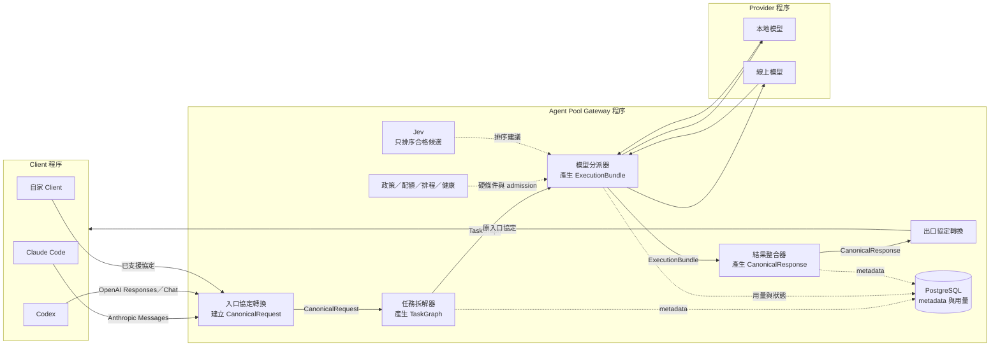

# 多模型任務編排規格

## 目標

各家 Client 只在入口與出口保留協定差異。請求轉成 `CanonicalRequest` 後，由三個獨立元件完成複合任務：任務拆解器產生任務圖、模型分派器執行任務圖、結果整合器產生一份 `CanonicalResponse`，最後再轉回原 Client 的格式。

## 系統邊界



實線是只在記憶體內流動的內容；虛線是控制或只含 metadata 的帳務資料。MCP 不是核心架構，也不是啟用多模型的必要條件。

## 共用資料契約

共用型別放在 `src/orchestration/contracts.rs`；不得把 Client 或 Provider 的 JSON 當成三個元件的介面。

```rust
pub struct TaskGraph {
    pub orchestration_id: Uuid,
    pub nodes: Vec<TaskNode>,
}

pub struct TaskNode {
    pub id: String,
    pub objective: String,
    pub task_kind: String,
    pub dependencies: Vec<String>,
    pub required_capabilities: CapabilityRequirements,
    pub data_policy: DataPolicy,
    pub output_contract: OutputContract,
}

pub enum DecompositionDecision {
    Direct { reason: String },
    Decomposed(TaskGraph),
}

```

共用契約另含 `ExecutionRole::{Decomposer, Worker, Integrator}`，因三個元件都要用它記帳。分派器在 `dispatch.rs` 擁有 `ExecutionBundle` 與 `TaskExecutionResult`。結果必須含 task ID、狀態、實際模型與 Provider、選擇理由、`CanonicalResponse` 或穩定錯誤碼、用量及延遲。Prompt、子任務輸入與模型輸出不寫入 log、trace、ledger 或 spool。

契約所有權固定，避免三個元件互改同一檔：拆解器擁有 `contracts.rs` 的 `TaskGraph`／`TaskNode`／`DataPolicy`／`ExecutionRole`；分派器只在 `dispatch.rs` 定義執行結果；整合器只在 `integration.rs` 定義整合輸入。後兩者只能消費已凍結的上游公開型別。

### 資料政策與能力來源

`DataPolicy` 只有 `LocalOnly`、`OnlineAllowed`、`OnlineRequired`，嚴格度依序為 LocalOnly、OnlineAllowed；OnlineRequired 是執行需求，不得覆蓋上游 LocalOnly。來源依序為 tenant hard policy、原請求 opt-in、拆解節點繼承；模型只能收緊，不能放寬。任何 LocalOnly 請求及衍生內容都不得送 Jev，因為現有 Jev 是外部 API；這時只用確定性候選排序。

能力判斷須先新增 `CapabilityRequirements::from_canonical(&CanonicalRequest)`，並讓既有入口和子任務共用。`from_request(operation, raw_json)` 只留作遷移期對照，完成後不得出現在 orchestration 路徑。子任務由 `TaskNode.required_capabilities` 與實際 canonical payload 合併，不能重建 Client JSON。

## 1. 任務拆解器

責任只有判斷 `CanonicalRequest` 是否為複合任務，並在需要時建立完整、無重複、無新增意圖的有向無環任務圖。

- 簡單請求回 `Direct`，沿用既有單模型路徑。
- 最多 8 個節點、最長依賴鏈 2 層；節點不可再次拆解。
- 每節點帶任務種類、必要能力、資料政策與輸出契約。
- 模型提出的圖由程式驗證 ID、依賴、循環、目的、上限與資料政策。
- 第一階段只跑 shadow，不觸發工作模型。
- tenant 模式預設 `disabled`；只有明確開成 `shadow` 才呼叫拆解模型。拆解模型也先過資料政策、能力、tenant policy、預算與健康條件；LocalOnly 只能用本地模型、不得呼叫 Jev，沒有合格模型就 `Direct`。
- Client 工具、強制工具選擇、無法安全投影的原生欄位及 token-count 第一版一律 `Direct`。
- 歷史訊息含 `ToolCall` 或 `ToolResult` 也一律 `Direct`，直到 Client 工具續輪另有完整設計。
- 逾時、低信心、格式錯誤或驗證失敗回 `Direct` 並記 reason code，不擋原請求。

品質門檻：固定複合案例的必要子任務召回率至少 90%，新增或改變意圖為 0；簡單案例 100% 回 `Direct`。

## 2. 模型分派器

責任是執行已驗證的 `TaskGraph`，不改任務內容，也不合成答案。

每節點依序經過資料政策、必要能力、tenant 政策、預算／配額、Provider 健康與 Scheduler admission。只有通過硬條件的候選可交給 task profile 與 Jev 排序；Jev 失敗時使用確定性第一名。

- 最多 3 個節點同時執行；每節點最多一次 Provider 呼叫，沒有模型驅動重試。
- `local_only` 找不到本地候選時 fail closed。
- `local_only` 不呼叫 Jev；其他政策只有在內容外送已獲准時才可呼叫 Jev。
- 依賴失敗時下游為 `skipped_dependency`；獨立節點保留結果。
- Client 取消時停止未開始節點並取消進行中呼叫；重啟不重送未知狀態工作。
- 子呼叫重用既有 policy、quota、scheduler、router、adapter 與 ledger。
- 父、子及整合請求以 `orchestration_id`、`task_id`、`execution_role` 關聯；用量逐筆記一次。

Jev 不是授權來源、能力判斷器、排程器、重試器或整合器；它只對已合格候選提供排序建議。

## 3. 結果整合器

責任是把原始請求、任務圖與子結果交給另行分派的整合模型，再經程式檢查後產生唯一 `CanonicalResponse`。

- 整合模型由分派器選擇，角色為 `integrator`，仍受全部硬條件限制。
- 原始要求、task 結果、證據、錯誤與限制明確分隔；子結果一律視為不可信資料。
- 模型前檢查必填節點與大小；模型後檢查 task 覆蓋、矛盾揭露、schema、task ID 引用與輸出上限。
- 必要節點失敗不得假裝完整；非必要節點失敗可整合，但須揭露缺口。
- Client 只收到一份回應；wire model 保留公開別名，用量回整批 aggregate usage，內部模型明細只給授權 Admin。
- 第一版內部階段不串流，只有整合模型最終輸出走既有 canonical stream；取消傳到整張圖。
- 整段沿用 Client deadline；未提供時以接收時間加 600 秒。拆解、每個子任務及整合都有剩餘時間上限。stream 請求從編排開始即由既有 `services/streaming.rs` 每 30 秒送協定允許的 SSE comment heartbeat；deadline 不足以開始下一階段時回穩定逾時錯誤。

## 啟用順序

1. 拆解器 shadow，只量品質與額外延遲。
2. 分派器只在測試入口執行固定任務圖。
3. 整合器完成後，三者才以 tenant feature flag 串入資料面，預設關閉。
4. 正式 shadow 與單模型基準比較成功率、品質、p50／p95 延遲、Provider 成本與 Jev 成本。
5. 達到另行核准的門檻後才逐 tenant 啟用；任一元件可停用並退回單模型。

## 全域驗收與限制

- 同義請求從 Claude Code、Codex 與自家 Client 進來，正規化後得到等價任務圖；出口仍符合原協定。
- 圖限制為 8 節點、2 層依賴、3 並行；故意放寬限制時陰性測試必須失敗。
- 簡單、工具互動及不支援欄位維持原單模型路徑。
- `local_only` 內容與衍生結果 100% 不送線上 Provider。
- Provider 呼叫數等於已開始的拆解、工作與整合呼叫數；沒有隱藏重試或重複記帳。
- 內容不持久化；機密日誌檢查涵蓋拆解、子任務與整合。
- 不修改 Client、不使用訂閱 session token、不要求 MCP、不引入 LiteLLM。
- 正式啟用與付費實送須另行取得授權。

## 放棄的方案

- 由 Claude Code 拆解與整合：核心能力會綁定單一 Client。
- 由 Jev 包辦全部：候選排序不能取代政策、排程、圖驗證與答案驗證。
- 三個元件合成代理迴圈：故障、成本與生命週期無法獨立控制，且容易形成無界呼叫。
- 第一版支援 Client 工具迴圈：隱藏子模型無法替 Client 執行本地工具，會破壞協定。
