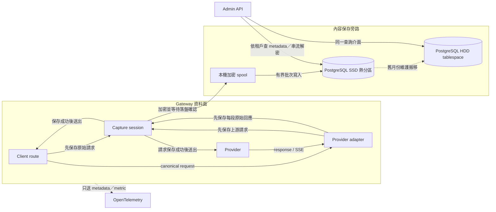

# Request／Response 全文保存設計

## 2026-11-10 用量重播的內容檢查

同一筆紀錄只能用相同內容重播。入庫前後會核對請求、送往模型的各次請求、逐筆用量、請求參數、歸因及已完成的結帳事件；每筆用量必須屬於同一租戶、原請求與模型請求。時間、編號及毫秒間隔先依實際資料欄位轉換，避免把相同值的不同表示誤判為衝突。尚未取得完整實際用量或金額時，保留既有未結帳狀態，不補造實際值。

內容有改動、遺漏或關聯衝突時，回傳 `GW409` 並撤回整批寫入；即使主鍵重複而未覆寫，也不能回成功。既有暫存流程會保留衝突原件，再個別處理同批的正常紀錄；這是另一次交易，不是衝突交易部分成功。交易仍限 `read committed`，也就是每個查詢讀取當時已提交資料，並沿用租戶鎖。[PostgreSQL交易說明](https://www.postgresql.org/docs/17/transaction-iso.html)與[JSON型別轉換](https://www.postgresql.org/docs/17/functions-json.html)是設計依據，正確性仍以本版反例及資料讀回判斷。

隔離原件在 `/home/cash/.local/state/ai-gateway/r3-usage-replay-20261110`。舊版接受改過的用量、狀態、歸因、參數及跨請求關聯；已結帳的實際值改空也會跳過比較。修正後14組內容/關聯混批及3組結帳空值均拒絕，逐欄完整快照不變；相同內容分開交易重播與並行重播成功，並行異內容或跨租戶相同編號只有一份成功。新增Rust回歸在舊版失敗，修正後帳本48項及結帳回歸通過。首次全套另找出舊恢復樣本漏標完成，導致重開被改成取消；只修樣本標記，未放寬內容檢查。完整本版檢查、原Client對帳與發布狀態另見同目錄原件；此段不代表R3期限、刪除或完整恢復已完成，正式尚未更新。

固定新版 `r3s3-8910bd1-ledger-replay` 使用原Claude與Codex完成6筆請求：3完成、2取消、1途中失敗，來源是受控協定回應，非本輪真模型。完成3筆各有回報輸入1/輸出1，Claude取消保留已收到的輸入1/輸出0；Codex取消及途中失敗未收到用量，沒有新增供應商實際用量列，不能把彙總畫面的0當作已知實際值。每筆估算、回報、模型請求、帳本及保存擁有者相符，4個資料庫的遷移檔雜湊與現檔相同，暫存沒有待寫或隔離衝突。原生樣本未設配額；額度另由真配額引擎的20預留→3結帳及重播/空值回歸驗證，未冒稱原生樣本扣過額度。最終全套通過；Rust6/Python20未跑，正式、完整期限/刪除/恢復及同版發布仍待。

## 2026-11-10 先存後送與內容下載驗收

R3-S2只新增驗收器，沿固定執行檔 `r1s3read-8f04a37-idempotent`；未改正式Rust、原Client或使用者預設。以 `--check-capture --check-capture-access --client claude|codex` 執行隔離HTTP，來源及身分是受控測試資料，不是正式來源或第二真人。

兩協定各47案：20次無權讀取拒絕且零來源，21次合法Admin內容下載皆禁止快取，另6次資料請求。A、B各自產生真保存資料，Admin只可讀本租戶；Operator/Viewer拒絕，Gateway金鑰不能冒管理session。四段均可讀回並保留雜湊，兩段回應與實際接收相同，請求標記及擁有者、租戶、請求相符；不是拿不存在的假資料冒跨租戶拒絕。原政策允許同租戶Admin依權限讀其他使用者，不新增一律拒絕的限制。[OWASP原則](https://cheatsheetseries.owasp.org/cheatsheets/Authorization_Cheat_Sheet.html)用於逐次核權，實際結果仍以上述HTTP與資料讀回為準。

| 保存故障 | 實際驗證 | 結果與界線 |
| --- | --- | --- |
| 請求送出前 | 只將新隔離保存目錄改為不可新增檔案，最後恢復權限 | 503、來源0；只有入口日誌，無capture/ledger，不冒已有失敗帳本 |
| 串流途中 | 先等Client看到已保存前段，再令下一次保存所需的容量鎖無法以讀寫開啟，才放行來源後段 | 來源確實送出後段，Client與合法讀回均無未保存後段或完成事件；HTTP已是200，保存為incomplete、帳本failed，之後新請求成功 |

每次來源收到請求時，已能看到兩段請求密文。每協定來源5次、4筆完整/1筆不完整保存，帳本4完成/1失敗、21筆Admin下載稽核；94個案例入口與日誌狀態全部對回。中途測試核對的是保存與轉送的先後，未宣稱實際斷電安全、所有故障排列或兩原Client在此種保存故障下的操作結果。

以Admin取代Viewer時確實讀到私有原文；前段不注入故障時實際200/來源1；中途不注入故障時，標為不應送出的測試後段及完成事件均流出，此控制組實際可正常保存。三個原命令都退出1，證明驗收器會拒絕這些錯誤結果，不代表產品曾有越權或先送漏洞。選項 `--control-capture-access viewer|before|during` 只供此模式。

舊真模型工具/取消原件不是此執行檔，沒有冒同版。沿既有工具另跑原Claude與Codex受控來源：工具各2次來源、8段加密讀回，真的執行本機Read或exec_command並保留原上下文；SIGINT取消各1次來源、4段不完整讀回、帳本cancelled及來源關閉，Gateway活動數歸零。六組同執行檔的原Client上游錯誤/恢復原件核後沿用，沒有重跑未變真模型；完整同版真來源及發布仍屬後續驗收。

獨立審查抓到正常回覆標記漏掃、此模式提前返回而漏掉最後DB/spool掃描，以及英文失敗訊息。已重用既有raw/hex明文檢查、補正常兩協定回覆/請求與故障標記/秘密，檢查最後日誌、保存暫存與記憶體中的DB匯出；只保存摘要，不落明文dump，並將新增錯誤訊息改繁中。新檢查在兩份原庫/原檔重放通過，四個追加正常回覆的raw/hex洩漏反例被拒絕；原HTTP授權/故障邏輯僅訊息改字，沒有重送相同來源。兩個全新上下文審查者只重審改段，均無新發現；靜態審查不取代實測。

最初CLI漏允許新模式，以及短於實際30秒入庫週期的等待失敗均保留；修正驗收器後才計最終94案，未改產品維護週期或放寬預期狀態。完整538Rust/272Python/22前端及33個守門反例通過，Rust6/Python20未跑。原件 `/home/cash/.local/state/ai-gateway/r3-capture-access-20261110/summary.json`。S3內容重播與結帳、S4期限刪除/完整隔離還原、S5故障恢復及正式配置/同版發布仍未完成，正式環境未動。

## 2026-11-10 資料、讀取權限與恢復來源核對

R3-S1依 `d27da71` 原碼及本輪唯讀結果核對；未改正式服務、角色或資料，未建立備份、還原或重送模型。原件在 `/home/cash/.local/state/ai-gateway/r3-records-map-20261110/`，以下隔離結果不代表正式已具備保存能力。下文的歷史設計與待辦仍須對照實碼，不以文字宣告完成。

| 資料 | 擁有者與允許讀取者 | 現況與恢復來源 |
| --- | --- | --- |
| 對話密文與索引 | 每筆綁租戶、使用者及請求；候選版下載路徑限同租戶有效Admin帳號、登入憑證及session | 既有本人Codex隔離樣本1筆完整、61區塊，DB保存密文；恢復需要一致DB與暫存。Operator/Viewer及跨租戶HTTP拒絕待S2新驗 |
| 本人讀取與刪除 | 候選版端點有本人刪除，核活躍Gateway金鑰與租戶/使用者；個人讀取的read_verified僅測試編譯 | 不把測試函式當已交付的本人讀取API；本輪未執行刪除 |
| 帳本及用量 | 同請求與使用者；服務DB角色可讀，API另依管理權限 | 樣本1筆完成嘗試、估算及回報各1列；回報一般輸入13184、快取3712、輸出9。恢復須連同額度保留及結帳事件，不只總額 |
| 加密主金鑰及計數 | 隔離檔案UID1000、目錄0700/檔案0600，僅列指紋不輸出密鑰 | 實際32 bytes金鑰雜湊、current與DB指紋一致；舊金鑰供解密，還原後新寫入須換新金鑰及計數，不沿用回退額度 |
| 暫存及保存期限 | 同一使用者；背景匯入/清理受既有鎖限制 | 本次暫存已歸零，DB仍61區塊；期限實際30天，尚未過期。檔案權限及雜湊逐項保存，未因舊紀錄稱暫存仍有1份 |
| 刪除紀錄及見證 | 獨立保管的最新刪除位置，不能和舊DB一起回退 | 此隔離樣本位置0、無刪除標記/DB恢復底線，只用同機測試見證；錯誤位置被CLI拒絕且原檔不變。不能冒防刪除復活證明 |
| DB角色及正式版本 | 本機測試與正式gateway角色目前都superuser/bypassrls；沒有專用帳務/備份角色 | 正式153ac60b、PG17.11/gateway_jev_local沒有capture表；只明確掛帳本暫存，未明列內容保存路徑/掛載。既有備份只讀前查直接拒絕缺掛載，未建立輸出 |

61筆事件依位置及各方向序號連續，數量為請求1/上游請求1/上游回應44/Client回應14/加密完整性紀錄1；與同一擁有者的帳本及4次Admin下載稽核對回。`sample-manifest.json` 保存每筆密文雜湊及整表雜湊，沒有重新解密的明文內容雜湊，不能代替S2讀回或S3內容重播核對。

實際權限對照：gateway可讀61個密文區塊，既有無capture表格權限的編譯專用角色讀取被拒；後者不是已配置的一般帳務帳號。兩個隔離資料庫表未啟用RLS，應用程式逐次驗權與DB登入權限必須分開判定；這些結果不能推出已發生跨租戶洩漏。[PostgreSQL17原文](https://www.postgresql.org/docs/17/ddl-rowsecurity.html)說明superuser及bypassrls會繞過列權限，不能以此角色測得成功冒一般角色隔離；[備份說明](https://www.postgresql.org/docs/17/backup-dump.html)的DB一致快照也不涵蓋外部暫存及刪除見證。

現有備份工具需DB及capture/ledger暫存鎖、加密四個輸出並簽署刪除位置；還原工具保留原碼的目標隔離、換新金鑰及位置標記。工具存在與前查拒絕都不是真還原證據。下一步S2沿既有驗收工具補授權下載/跨租戶角色拒絕、保存故障必須在送出前拒絕，以及日誌無內容；正常、工具、取消及上游拒絕的同版既有資料先核再沿用，不重跑真模型。S3–S5的內容重播、期限刪除、完整隔離還原與故障、正式最低必要權限及發布門檻仍保留。

## 目的

試行期預設開啟，保存每一次模型請求與回應，讓後續能比較 Prompt、Skill、模型與 Agent
版本的品質。請求及每段回應必須先寫入加密保存層並確認持久化，再送往下一方；保存失敗不得被當成成功。資料庫暫時不可用但加密暫存仍可持久保存時，串流可以繼續。

## 技術選型

採用「PostgreSQL metadata + 分區 `BYTEA` 全文」：

- PostgreSQL 保存租戶、請求、模型、Agent／Prompt／Skill 版本、雜湊、大小、保存期限、完整性狀態及加密後全文。
- 目前整個資料庫放 SSD。全文表依月份分區；未來有 HDD 時，把過期但仍需保留的舊月份分區搬到 HDD tablespace，程式與查詢介面不變。
- 每個 block 的明文最多 1 MiB，長內容切成有順序的 `BYTEA` block，避免單列過大並支援串流讀寫；PostgreSQL 仍會用 TOAST 處理寬欄位。
- OpenTelemetry 只保存不含內容的計數、延遲與錯誤，不承載 Prompt／Response 全文。
- 不引入 ClickHouse。第一版的需求是依 request、session、版本與時間查找，不是大規模任意分析；等實測查詢量證明 PostgreSQL 不足才另立遷移計畫。

不選 S3／MinIO：目前沒有雲端或 NAS，新增一套物件服務只會增加部署、帳密、備份與故障點。
不選「全文放 OTel」：OpenTelemetry 明確指出模型輸入輸出敏感且可能很大，預設不應擷取；遙測與
內容也需要不同權限。

## 保存範圍

每個 Gateway request 保存四段，才能找出轉譯前後差異：

1. `client_request`：Client 送進 Gateway 的 body。
2. `provider_request`：Gateway 實際送給 Provider 的 body；不得包含 Authorization、API key 等 header。
3. `provider_response`：Provider 回給 Gateway 的 body 或逐段串流資料。
4. `client_response`：Gateway 實際回給 Client 的 body 或逐段串流資料。

非串流內容保存原始 bytes。串流內容保存有順序的 frame：序號、相對時間、方向、bytes；重播時不得
用重新解析後的 JSON 取代原始資料。每段都保存 SHA-256、明文／密文大小及完成狀態。

## 歸因資料

Gateway 已能取得 tenant、user、device、client、agent、credential、session、model、provider、
request id 與 trace id。Client 可再送下列選用 header；值只進 PostgreSQL metadata，不轉送 Provider：

- `x-apg-prompt-id`、`x-apg-prompt-version`
- `x-apg-skill-set-id`：由 Client 對排序後的 `skill@version` 清單計算 SHA-256。
- `x-apg-agent-name`、`x-apg-agent-version`
- `x-apg-client-version`
- `x-apg-task-id`：Agent 的任務編號；同一任務的每個請求帶同一個值。

Gateway 只認請求，不知道「任務何時算完成」（含人工核准、工具執行）。任務完成時間由 Agent 記；Gateway
用 `x-apg-task-id` 把同一任務的請求串起來，並提供每個請求的完成時間（帳本 `completed_at`）。兩邊靠這個編號對得上。

每值限制 128 bytes、僅接受可列印 ASCII；缺少時保存 `NULL`，不得從 Prompt 內容猜測。既有 Client
不送這些 header 時行為不變。

這些 header 只用來歸因，不能影響請求本身：缺少、過長或含不合格字元時，該值一律存 `NULL`，請求照常處理，
不回 4xx，也不排隊失敗。`x-apg-task-id` 漏送只會讓該請求不歸入任何任務。

目前兩種請求入口建立帳本紀錄時，會把合格的歸因值寫入獨立資料表；已進入帳本的格式、政策與額度拒絕也會記錄。此變更尚未部署，也不代表全文保存已接入。

## 資料流

實線是請求、回應或內容資料；虛線是不含內容的遙測。Capture 在 Gateway 行程內，
SSD 與 HDD 都由同一個 PostgreSQL cluster 管理；HDD 不存在時只使用 SSD。

## 完整性與故障行為

- 啟用全文保存的請求，必須先把 `client_request`、`provider_request` 與 capture manifest 加密寫入有上限的本機 spool，確認持久化後才送 Provider。
- 每批 Provider 回應與將送給 Client 的資料，均須先加密寫入 spool 並確認持久化，才送 Client；等待隊列不得無界成長。
- 資料庫故障時，只要 spool 仍能持久保存就繼續串流並待恢復後寫入；若 spool 無法保存，停止轉送、將 capture 標成 `incomplete` 並告警，不能默默算完整。
- spool 滿時，新請求在送 Provider 前回穩定的 `503 capture_unavailable`；避免接受後才無聲遺失。
- 開發版會先保留可恢復的帳本紀錄，再準備本人來源與加密保存。這些準備工作失敗且尚未送模型時，帳本記失敗、實際用量為零，由既有入帳流程只結帳一次並回收文字用量的估量；已送模型卻沒有實際用量者仍保留未知，不能當零。帳本本身無法建立時的額度回收，以及資料庫／程序中斷的完整恢復仍待驗收，尚未部署。
- 批次寫入以 `capture_id + leg + block_sequence` 作冪等鍵；重試先查現有 block 雜湊，不盲目重寫。
- 正常關閉會停止接新 capture、等待既有 frame 落盤，再依既有 shutdown 上限結束；未完成項目下次啟動續傳。

## 安全與保存期限

- 試行期全文保存預設開啟（使用者 2026-10-29 定）；全域 `CONTENT_CAPTURE_ENABLED=false` 或租戶政策不是 `full` 時關閉。體積過大就退回只記摘要。
- 政策的 `constraints.content_capture` 可設 `full` 或 `metadata`；各層取較嚴格的限制，任何一層設 `metadata` 都不保存全文。`constraints.content_retention_days` 為 1–365，各層取較短期限，未設定為 30 天。啟動須先驗證金鑰、錨點、刪除紀錄及獨立見證，完成後才能接受全文保存；沒有完成啟動驗證的請求在供應商呼叫前回 `503 capture_unavailable`。正式環境設定已在隔離容器驗過保存、刪除及還原後持續保存，尚未部署到正式服務；各協定與原 Client 的驗收邊界見母檔04。
- body 在寫入 spool 或 PostgreSQL 前，以每個 capture 的獨立資料金鑰做 AES-256-GCM 分塊加密；資料金鑰再由版本化主金鑰包裝。主金鑰由安全亂數產生 32 bytes，存在受限檔案而非資料庫；啟動會檢查金鑰與目錄。正式保管及部署流程尚未驗收。
- 全新保存區初始化時，會先在受限金鑰目錄保存初始化意圖，再建立金鑰、計數檔及目前金鑰指向。中斷後，僅在資料庫與暫存仍符合初始化條件、既有檔案與意圖相符時續跑；資料不符就保留原檔並拒絕。意圖尚在時服務不使用該金鑰，備份也會拒絕。建立意圖前若留下未完成暫存檔，目前會拒絕並需人工檢查；若資料庫、計數檔與意圖同時回退，仍無法自動判定金鑰曾否使用。
- 加密使用隨機 96 位元 nonce 時，同一把金鑰的加密次數必須有持久、跨程序可檢查的上限；主金鑰最多包裝 1,048,576 次，每個 capture 每個方向最多 1,000,000 區塊。主金鑰以 SHA-256 指紋共用計數，同一金鑰換名稱不能重設；每次建立保存紀錄前先保留包裝額度，失敗的額度也不回收。上限依 [NIST SP 800-38D](https://nvlpubs.nist.gov/nistpubs/Legacy/SP/nistspecialpublication800-38d.pdf) 保守設定。開發請求流程已使用此保留機制，正式環境未驗收。
- 資料庫從備份還原時，計數可能退回舊值；必須先換用新主金鑰，再恢復新的內容寫入。舊主金鑰只供解密既有內容，不能繼續包裝資料金鑰。啟動及還原防呆尚未實作，不得把備份復原視為已完成驗收。
- 開發請求流程使用獨立保存的金鑰計數檔；若資料庫計數倒退而此檔仍保有較新的數值，會拒絕舊金鑰。計數檔不得與資料庫一同回復舊備份；若兩者一起回退，這項比對無法偵測，仍必須更換主金鑰。正式服務與備份流程尚未驗收。
- 開發版啟動及建立保存作業時會檢查全文暫存、金鑰及計數檔目錄；三者須使用互不重疊的絕對路徑，不能包含符號連結，目標與各層上級目錄須由服務使用者或 root 持有，且不能開放群組或其他人任意改寫。具有黏滯保護的共用暫存目錄，只允許底下項目由服務使用者或 root 持有。容器使用掛載目錄時須確認容器內看到的擁有者符合此規則；無 root 權限容器的使用者編號對應方式尚未實測。路徑檢查與後續開檔之間仍可能遭替換或重新掛載，不能當成完整防護。開啟全文保存時，金鑰及對應計數檔缺失或損壞會使啟動失敗。容器已分配三個獨立磁碟卷，但首次建立金鑰的正式流程與全文保存仍未完成，不得部署。
- 開發版已接入背景整理及四段內容的加密暫存，程式內測試涵蓋非串流、串流及失敗回應；部分原 Client 已在隔離環境實送。正式環境仍拒絕全文請求，完整驗收及部署尚未完成。
- PostgreSQL 只綁內網／localhost；全文表不授權一般帳務查詢角色，Admin 下載仍需另外驗權。
- 不保存認證 header、Provider credential、Gateway key、cookie；Admin 下載內容本身也要寫不可變 audit event。
- 租戶設定保存天數；第一版預設 30 天、允許 1–365 天。到期工作先分批刪除 content blocks，再將索引標成 `deleted`；刪除失敗重試並告警。
- 開發版在手動刪除或到期清理時，會在同一個資料庫交易寫入租戶與紀錄編號的刪除標記。背景匯入在建立紀錄前取得相同的非阻塞交易鎖並檢查標記，因此即使原紀錄列已移除，也不會重新匯入已標記的暫存。鎖忙時操作失敗，下一輪清理再處理；不同紀錄的鎖識別值可能碰撞，造成暫時拒絕。升級會為資料庫仍保有的 `deleting`、`deleted` 紀錄回填標記，無法回填已被實體移除的紀錄。此標記會隨資料庫一起回退，不能替代備份外的獨立刪除紀錄；正式環境尚未部署。
- 背景清理使用獨立的單一處理名額，即使保存請求的處理名額全滿也能嘗試清理。兩者仍共用資料庫連線，因此資料庫忙碌或故障時清理可能延遲。
- 帳本與 audit log 不跟內容一起刪。備份需定義同一保存政策，避免主資料刪了但備份永久保留。
- 待實作：使用者刪除紀錄時，先完成身分與權限確認，鎖住該紀錄，再在備份之外的獨立保存區持久記下租戶、紀錄編號與刪除次序；另一個可信且不隨備份回退的位置，須以不可倒退的方式保存最新次序和該筆紀錄的驗證值。完成上述兩次寫入後才刪資料庫及暫存，全部完成才回報刪除完成。不得寫入提示、回覆、憑證或資料金鑰。每一階段中斷都須可辨識並安全續跑，不得因資料庫交易失敗就丟棄已持久化的刪除意圖。
- 待實作：還原時保持目標隔離，先核對獨立刪除紀錄的來源、連續性及末筆驗證值與可信位置一致，依租戶和紀錄編號重放備份之後的刪除，連暫存一起清除，再確認已刪內容無法讀回且其他租戶與未刪紀錄不受影響，最後才允許啟動服務。紀錄、可信位置或其連續性無法確認時拒絕啟動；不能只驗雜湊鏈，因完整的舊版本也可能被整份回退。若刪除紀錄及可信位置同時回退或同時遺失，系統無法自行判定最新狀態，不能宣稱可安全還原。
- 備份保存時間須與刪除紀錄的可重放期間一致；開發版 Gateway 在開放服務前會分批恢復及清理已過期紀錄，再重掃暫存，遇到被鎖住的紀錄會等待並定期記錄狀態，可收到停止訊號。這會延後整個服務啟動；清理失敗時一般會保留資料並拒絕啟動。例外是不足完整檔頭且未被鎖住的截斷檔：會保留並記警告，因內容無法驗證，無法確認其身分或保存期限。備份副本仍可能含已刪密文及金鑰，重放刪除不等於已從備份副本移除資料，副本如何到期與刪除尚未定案。開發版已有部分接線和隔離測試，完整方案仍未驗收，不開放正式還原。參考 [歐洲資料保護委員會備份刪除研究](https://www.edpb.europa.eu/system/files/2026-02/edpb_cef-report_2025_right-to-erasure_en.pdf)。
- 容量待處理：目前刪除紀錄最多十萬筆，每次新增都重新驗證全部紀錄，達上限後無法再完成刪除。候選方向是將紀錄分段、在備份中記錄可驗證的位置，並只在確認所有可用備份不再需要舊紀錄後才考慮裁剪；還原時必須拒絕位置過舊或來源不符的備份。裁剪、舊格式相容、備份保存期限及中斷復原均未實作或驗證，不得自行刪除既有紀錄。
- 來源檢查進度：開發版新版備份會簽署刪除紀錄位置，隔離還原將該位置寫入資料庫，Gateway 啟動時核對持有的日誌；接錯來源會拒絕。資料庫原本沒有位置時目前只記警告並繼續啟動，這不適用於安全還原。隔離實測將日誌和見證同時回退到備份時的狀態，已刪資料仍會復活；正式還原仍不可開放。
- 中斷判讀進度：日誌校驗已能在不修改檔案的情況下辨識待完成紀錄；位置檢查以唯讀方式開檔並在有待復原紀錄時拒絕。一般啟動會先核對獨立見證，再決定是否完成本機復原；日誌已滿時復原會拒絕追加，保留既有內容。這條流程已在同機隔離環境驗證，跨主機尚未驗收。
- 獨立見證資料庫進度：已建立隔離測試用的 PostgreSQL 結構與條件式更新介面，只保存安裝識別、次序與驗證值。一般見證帳號只能讀取及呼叫更新函式，不能直接新增、刪除、覆寫或清空位置；函式擁有者須是無登入權限且不屬於其他角色的非特權角色。見證帳號若遭盜用，仍可送入假的下一個驗證值使服務拒絕運作。管理者仍能更改或重建位置，必須獨立管理並核對來源，不能把待還原的舊資料自動當作初始位置；見證遺失時無法自行確認最新狀態。Gateway 的刪除、啟動及驗證伺服器身分的加密連線已接入並經同機隔離測試；見證資料庫及其備份仍須與 Gateway 分開管理，不能將同機測試視為正式防回退驗收。
- Gateway 每次讀取或更新見證前，會檢查目前角色與繼承角色的敏感權限，並拒絕可呼叫見證更新函式以外的其他高權限函式；同機隔離測試涵蓋新增直接寫入權限及新增高權限函式。檢查是當下的快照，無法阻止管理者在檢查後改權限；若權限已被擴大，持有見證帳號的人仍可繞過 Gateway 直接更改見證，事後收回權限也無法證明見證未被改過。因此仍須專用資料庫、獨立管理及稽核。Gateway 拒絕仍在備援狀態的見證資料庫，並在更新時要求交易同步提交；已升格但資料落後的備援仍可能被當成主庫。殺死測試容器後可讀回，不能證明斷電或非同步備援切換不會遺失位置。
- 還原中斷保護進度：開發版還原會先建立未完成標記，完成資料、金鑰及位置寫入後，才在資料庫交易中移除標記。新版 Gateway 與全文保存初始化會在資料庫遷移或建立金鑰前檢查標記，存在時拒絕；舊版 Gateway 不具備這項檢查。此流程目前只做隔離驗證，不能取代正式環境、原 Client、獨立防回退及備份副本刪除驗收。
- 加密備份工具目前仍屬隔離原型：備份時會同時取得內容與帳本鎖，帳本啟動復原、請求寫入及補寫資料庫期間也會持鎖。取消背景寫入及整體還原仍有待驗證的情境，不能用此工具做正式備份；正式備份入口仍會拒絕含內容保存資料表的資料庫。備份期間若啟動復原拿不到鎖，服務會拒絕啟動，需待備份結束後重啟。

## 正式設定的隔離驗證

`test_capture_backup_gateway.py --credential-environment prod --check-deletion --check-remote-replay --check-protocol-streams` 會建立獨立測試資料庫、見證、假供應商與保存區，結束後清除。它透過真正管理API設定Messages與Responses模型，逐字比對串流、加密讀回與還原後讀回；供應商收到請求時檢查兩段加密請求已存在。另將保存目錄改為不可寫，確認兩端點都回503且上游計數不變。這證明同機隔離的HTTP與保存流程，不能代替原Client、正式資料、跨主機、斷電或獨立管理見證的驗收。

備份鎖租約結束時會明確解鎖，避免仍存活的複製描述符延長鎖定；解鎖失敗會記錄錯誤。保留描述符的測試已證明舊邏輯失敗、修正後通過。

備份可用 `capture_backup.py --database-user <帳號>` 或 `CAPTURE_BACKUP_DATABASE_USER` 指定獨立資料庫帳號，命令參數優先；`backup.sh create` 也沿用此環境設定。未指定時維持使用 Gateway 帳號。指定後，資料庫身分查詢與整份資料庫匯出都使用指定帳號，失敗不改用 Gateway 帳號重試；容器、連線目標及資料庫來源仍依 Gateway 設定核對。帳號名稱限英文字母或底線開頭，後接英數字或底線，最多 63 字元。

獨立備份帳號需有資料庫連線、保存所在結構的使用權、所有應備份資料表及序列的讀取權，以及 `pg_control_system()` 的執行權。後續遷移建立的結構、資料表與序列也須沿用預設讀取授權；其他擁有者新建的物件仍須另外授權。不要授予新增、修改、刪除資料或繞過列級權限的能力。遇到列級權限使完整匯出不可讀時，備份須失敗，不啟用只備份可見資料的選項。還原會保留來源的擁有者與授權，因此須先在隔離目標建立相同名稱的角色；備份專用角色可先設成不可登入。正式角色與備份排程尚未變更。

## SSD 搬到 HDD／NAS

- 一開始只在既有 SSD 預設 tablespace 建立每月全文分區，不預先要求 HDD。
- HDD 就緒後，由操作人員先掛載固定路徑並建立 PostgreSQL tablespace；新舊位置都必須在同一 cluster 可用。
- 只搬已封存、不再寫入的完整月份分區；逐一移動 table 與 index，前後以 `pg_relation_filepath`、筆數、總 bytes 與抽樣 SHA-256 驗證。
- `ALTER TABLE ... SET TABLESPACE` 會取得鎖並實際搬資料，不在流量尖峰執行；先量一個小分區的時間與磁碟空間。
- 若 NAS 只是網路分享，不直接當 PostgreSQL live tablespace；先把它當備份目的地。要放 live data，應讓 PostgreSQL 跑在可靠掛載／NAS 主機上，另做斷線與 fsync 耐久測試。

## 查詢契約

- `GET /admin/v1/request-captures?created_before=&status=&model=&agent_id=&limit=&cursor=`：依
  `(created_at DESC, id DESC)` 游標分頁，`limit` 1–100。
- `GET /admin/v1/request-captures/{id}`：開發版限管理員查詢同租戶的紀錄編號、使用者、狀態、建立及到期時間，以及四個方向各有多少加密區塊；查詢會重新核對登入狀態並先寫稽核紀錄，不回全文或金鑰。區塊數不是完整性驗證，完整性仍須解密核對。
- `GET /admin/v1/request-captures/{id}/content?leg=client_request`：開發版限管理員讀取，方向可選 `client_request`、`provider_request`、`provider_response` 或 `client_response`。Gateway 先記錄讀取嘗試，核對登入、保存期限與內容完整性後分段解密；不發可繞過 Gateway 權限的公開網址。網路中斷、大檔及部署驗收尚未完成。
- 不存在或不屬於目前 tenant 一律 404；已到期回 410；儲存暫時故障回 503 與 `Retry-After`。

- `DELETE /v1/request-captures/{id}`：使用自己的 Gateway 金鑰刪除自己的紀錄；其他使用者或不存在的紀錄回 404。資料庫與暫存檔均清除才回 204，仍有批次或暫存檔待處理回 202，背景程序繼續清除；重複請求可安全執行。此功能尚未部署。

## 衡量與驗收

- 指標：capture 接受／完整／不完整／拒絕數、spool bytes、資料庫批次延遲、各分區 bytes、四段 bytes、到期刪除積壓。
- 主要驗收：OpenAI Responses、Chat Completions、Anthropic Messages 的串流與非串流各一筆，四段雜湊吻合實際 wire bytes；跨協定請求能看見轉譯差異。
- 陰性對照：關閉租戶政策時不得產生 content block；把 spool 容量降到一筆也放不下時，請求必須在呼叫 Provider 前失敗。
- 效能門檻：開啟保存後，1 MiB 非串流與 1000-frame 串流的 p95 Gateway overhead 相對基準增加不超過 5%，且 Provider／Client 慢速測試不增加未界定記憶體。

## 研究依據

- [OpenTelemetry GenAI spans](https://github.com/open-telemetry/semantic-conventions-genai/blob/main/docs/gen-ai/gen-ai-spans.md)：內容敏感且可能很大，預設不擷取，開啟時可截斷或另行上傳。
- [OWASP Logging Cheat Sheet](https://cheatsheetseries.owasp.org/cheatsheets/Logging_Cheat_Sheet.html)：敏感資料需遮蔽／加密，測試儲存失敗，存取需受控並遵守保存期限。
- [Langfuse Data Retention](https://langfuse.com/docs/administration/data-retention)：trace 內容、audit 與評估資料採不同保存生命週期。
- [PostgreSQL TOAST](https://www.postgresql.org/docs/current/storage-toast.html)：寬 `BYTEA` 會自動壓縮或移到表的 TOAST 儲存。
- [PostgreSQL partitioning](https://www.postgresql.org/docs/17/ddl-partitioning.html)：分區可各自指定 tablespace，較少使用的資料可移到較慢媒體。
- [PostgreSQL ALTER TABLE](https://www.postgresql.org/docs/17/sql-altertable.html)：`SET TABLESPACE` 會搬移 table，index 需另行搬移並注意鎖。
