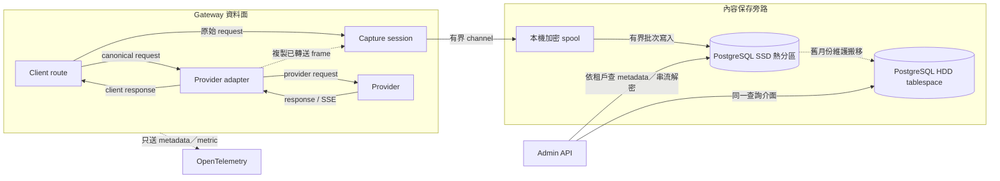

# Request／Response 全文保存設計

## 目的

試行期預設開啟，保存每一次模型請求與回應，讓後續能比較 Prompt、Skill、模型與 Agent
版本的品質。保存失敗不得被當成成功；同時不得因分析系統故障中斷已開始的模型串流。

## 技術選型

採用「PostgreSQL metadata + 分區 `BYTEA` 全文」：

- PostgreSQL 保存租戶、請求、模型、Agent／Prompt／Skill 版本、雜湊、大小、保存期限、完整性狀態及加密後全文。
- 目前整個資料庫放 SSD。全文表依月份分區；未來有 HDD 時，把過期但仍需保留的舊月份分區搬到 HDD tablespace，程式與查詢介面不變。
- 每個 block 的明文最多 1 MiB，長內容切成有順序的 `BYTEA` block，避免單列過大並支援串流讀寫；PostgreSQL 仍會用 TOAST 處理寬欄位。
- OpenTelemetry 只保存不含內容的計數、延遲與錯誤，不承載 Prompt／Response 全文。
- 不引入 ClickHouse。第一版的需求是依 request、session、版本與時間查找，不是大規模任意分析；等實測查詢量證明 PostgreSQL 不足才另立遷移計畫。

不選 S3／MinIO：目前沒有雲端或 NAS，新增一套物件服務只會增加部署、帳密、備份與故障點。
不選「全文放 OTel」：OpenTelemetry 明確指出模型輸入輸出敏感且可能很大，預設不應擷取；遙測與
內容也需要不同權限。

## 保存範圍

每個 Gateway request 保存四段，才能找出轉譯前後差異：

1. `client_request`：Client 送進 Gateway 的 body。
2. `provider_request`：Gateway 實際送給 Provider 的 body；不得包含 Authorization、API key 等 header。
3. `provider_response`：Provider 回給 Gateway 的 body 或逐段串流資料。
4. `client_response`：Gateway 實際回給 Client 的 body 或逐段串流資料。

非串流內容保存原始 bytes。串流內容保存有順序的 frame：序號、相對時間、方向、bytes；重播時不得
用重新解析後的 JSON 取代原始資料。每段都保存 SHA-256、明文／密文大小及完成狀態。

## 歸因資料

Gateway 已能取得 tenant、user、device、client、agent、credential、session、model、provider、
request id 與 trace id。Client 可再送下列選用 header；值只進 PostgreSQL metadata，不轉送 Provider：

- `x-apg-prompt-id`、`x-apg-prompt-version`
- `x-apg-skill-set-id`：由 Client 對排序後的 `skill@version` 清單計算 SHA-256。
- `x-apg-agent-name`、`x-apg-agent-version`
- `x-apg-client-version`
- `x-apg-task-id`：Agent 的任務編號；同一任務的每個請求帶同一個值。尚未實作。

Gateway 只認請求，不知道「任務何時算完成」（含人工核准、工具執行）。任務完成時間由 Agent 記；Gateway
用 `x-apg-task-id` 把同一任務的請求串起來，並提供每個請求的完成時間（帳本 `completed_at`）。兩邊靠這個編號對得上。

每值限制 128 bytes、僅接受可列印 ASCII；缺少時保存 `NULL`，不得從 Prompt 內容猜測。既有 Client
不送這些 header 時行為不變。

這些 header 只用來歸因，不能影響請求本身：缺少、過長或含不合格字元時，該值一律存 `NULL`，請求照常處理，
不回 4xx，也不排隊失敗。`x-apg-task-id` 漏送只會讓該請求不歸入任何任務。

## 資料流

實線是請求、回應或內容資料；虛線是旁路複製與不含內容的遙測。Capture 在 Gateway 行程內，
SSD 與 HDD 都由同一個 PostgreSQL cluster 管理；HDD 不存在時只使用 SSD。

## 完整性與故障行為

- 啟用全文保存的請求，必須先把 `client_request` 與 capture manifest 寫入有上限的本機 spool，才送 Provider。
- Provider 回應先送 Client，同一批 bytes 再交給 capture channel；channel 不得無界成長。
- 串流已開始後若 spool 或資料庫故障，串流繼續；capture 標成 `incomplete`，留下原因並告警，不能默默算完整。
- spool 滿時，新請求在送 Provider 前回穩定的 `503 capture_unavailable`；避免接受後才無聲遺失。
- 批次寫入以 `capture_id + leg + block_sequence` 作冪等鍵；重試先查現有 block 雜湊，不盲目重寫。
- 正常關閉會停止接新 capture、等待既有 frame 落盤，再依既有 shutdown 上限結束；未完成項目下次啟動續傳。

## 安全與保存期限

- 試行期全文保存預設開啟（使用者 2026-10-29 定）；全域 `CONTENT_CAPTURE_ENABLED=false` 或租戶政策不是 `full` 時關閉。體積過大就退回只記摘要。
- body 在寫入 spool 或 PostgreSQL 前，以每個 capture 的獨立資料金鑰做 AES-256-GCM 分塊加密；資料金鑰再由版本化主金鑰包裝。主金鑰不能存在資料庫。
- PostgreSQL 只綁內網／localhost；全文表不授權一般帳務查詢角色，Admin 下載仍需另外驗權。
- 不保存認證 header、Provider credential、Gateway key、cookie；Admin 下載內容本身也要寫不可變 audit event。
- 租戶設定保存天數；第一版預設 30 天、允許 1–365 天。到期工作先分批刪除 content blocks，再將索引標成 `deleted`；刪除失敗重試並告警。
- 帳本與 audit log 不跟內容一起刪。備份需定義同一保存政策，避免主資料刪了但備份永久保留。

## SSD 搬到 HDD／NAS

- 一開始只在既有 SSD 預設 tablespace 建立每月全文分區，不預先要求 HDD。
- HDD 就緒後，由操作人員先掛載固定路徑並建立 PostgreSQL tablespace；新舊位置都必須在同一 cluster 可用。
- 只搬已封存、不再寫入的完整月份分區；逐一移動 table 與 index，前後以 `pg_relation_filepath`、筆數、總 bytes 與抽樣 SHA-256 驗證。
- `ALTER TABLE ... SET TABLESPACE` 會取得鎖並實際搬資料，不在流量尖峰執行；先量一個小分區的時間與磁碟空間。
- 若 NAS 只是網路分享，不直接當 PostgreSQL live tablespace；先把它當備份目的地。要放 live data，應讓 PostgreSQL 跑在可靠掛載／NAS 主機上，另做斷線與 fsync 耐久測試。

## 查詢契約

- `GET /admin/v1/request-captures?created_before=&status=&model=&agent_id=&limit=&cursor=`：依
  `(created_at DESC, id DESC)` 游標分頁，`limit` 1–100。
- `GET /admin/v1/request-captures/{id}`：回 metadata 與四段完整性，不回全文。
- `GET /admin/v1/request-captures/{id}/content?leg=client_request`：Admin 才能讀，Gateway 驗權後串流解密；不發可繞過 Gateway 權限的公開網址。
- 不存在或不屬於目前 tenant 一律 404；已到期回 410；儲存暫時故障回 503 與 `Retry-After`。

## 衡量與驗收

- 指標：capture 接受／完整／不完整／拒絕數、spool bytes、資料庫批次延遲、各分區 bytes、四段 bytes、到期刪除積壓。
- 主要驗收：OpenAI Responses、Chat Completions、Anthropic Messages 的串流與非串流各一筆，四段雜湊吻合實際 wire bytes；跨協定請求能看見轉譯差異。
- 陰性對照：關閉租戶政策時不得產生 content block；把 spool 容量降到一筆也放不下時，請求必須在呼叫 Provider 前失敗。
- 效能門檻：開啟保存後，1 MiB 非串流與 1000-frame 串流的 p95 Gateway overhead 相對基準增加不超過 5%，且 Provider／Client 慢速測試不增加未界定記憶體。

## 研究依據

- [OpenTelemetry GenAI spans](https://github.com/open-telemetry/semantic-conventions-genai/blob/main/docs/gen-ai/gen-ai-spans.md)：內容敏感且可能很大，預設不擷取，開啟時可截斷或另行上傳。
- [OWASP Logging Cheat Sheet](https://cheatsheetseries.owasp.org/cheatsheets/Logging_Cheat_Sheet.html)：敏感資料需遮蔽／加密，測試儲存失敗，存取需受控並遵守保存期限。
- [Langfuse Data Retention](https://langfuse.com/docs/administration/data-retention)：trace 內容、audit 與評估資料採不同保存生命週期。
- [PostgreSQL TOAST](https://www.postgresql.org/docs/current/storage-toast.html)：寬 `BYTEA` 會自動壓縮或移到表的 TOAST 儲存。
- [PostgreSQL partitioning](https://www.postgresql.org/docs/17/ddl-partitioning.html)：分區可各自指定 tablespace，較少使用的資料可移到較慢媒體。
- [PostgreSQL ALTER TABLE](https://www.postgresql.org/docs/17/sql-altertable.html)：`SET TABLESPACE` 會搬移 table，index 需另行搬移並注意鎖。
