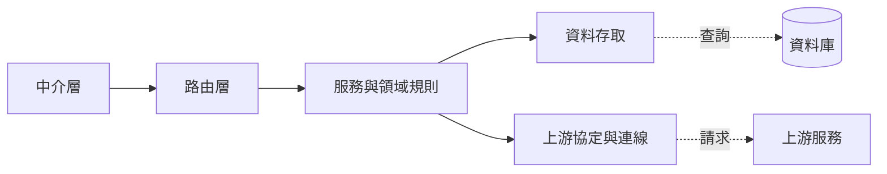

# 程式架構整理計畫

2026-11-05 23:00 優先級更新：本計畫延後，先完成[唯一母檔](../loops/gateway-completion.loop.md)的R1原Client日常工作、R2合法帳號與權限、R3安全保存恢復。只整合及修正這三項必要路徑，不先全面搬SQL、去註解或拆程序。以下舊工作樹、測試與行數是歷史，執行前須重查；不因三項完成就自動啟動本計畫。

目標：整理整個 `src` 的職責與依賴，保留現有行為，讓修改一項功能時能找到相關程式，且不必理解其他領域的內部實作。

## 已確認的現況

- 目前工作樹有未提交的規則與路由測試搬移；另一工作樹也有大量未提交修改，包含同一批路由與資料檔。執行前須確認整合基準和工作歸屬，保留兩邊內容。
- 路由測試原本內嵌在 `src/routes.rs`；目前已搬至 `src/routes/tests.rs`，快檢與測試編譯通過，51 項測試已列出但未執行。
- SQL 呼叫分布於管理、身分、配額、政策、模型與測試等模組；尚未逐條判定交易邊界、動態查詢及搬移方式。
- 尚未建立完整依賴圖，因此現有循環依賴、深層引用及巢狀程度不能先假定為零或宣稱已找齊。

## 2026-11-01 整合順序決定

`feature/gateway-completion` 相對 `main` 改了 77 個檔、約 13000 行，其中 `src/routes.rs` 增加約 1585 行；本工作樹把同一檔縮減約 3879 行。兩邊同時改會產生大量衝突，且重構會讓對方補丁找不到原位置。

決定：先整合 `gateway-completion`（含它的未提交修改，保留不覆蓋），再從整合後版本重做測試搬移與分層。放棄的做法：現在就繼續重構，代價是之後要重新套用或手解衝突。在整合完成前，本計畫的第 2 批以後不動手；第 1 批已完成的只有測試搬檔。

## 目標結構

下圖是整理後的依賴方向，並非宣稱目前已達成；箭頭表示程式依賴，資料存取與外部請求由各自實作處理。

- 中介層處理跨端點門檻；路由處理 HTTP 輸入、輸出及錯誤；服務處理業務決策與協調；資料存取封裝 SQL 和交易細節。啟動與設定負責組裝依賴，不讓資料層反向依賴路由。
- 一個領域的規則、資料存取及測試依實際變更關係組織；只暴露必要介面。模組宣告檔若有助辨識邊界就保留，純粹轉接且無實際用途才合併。
- 禁止模組依賴形成循環；跨領域只能使用對方公開介面，不引用其內部子模組或直接操作其資料表。依賴圖需含 `use`、完整路徑、重匯出與條件編譯；巨集產生的依賴另以編譯和人工審查補足。路徑字數或層數本身不是違規。
- 過深的回呼與條件巢狀按實際流程拆解；優先先處理錯誤並提早返回，必要時用 `match` 或小函式。避免硬性數字、無意義包裝及為抽象而抽象；保留交易、清理與取消的執行順序。
- `src` 的程式註解全部移除，包括文件註解；先用能辨識 Rust 字串、原始字串與巢狀區塊註解的語法工具盤點及移除，檢查文件測試影響；必要的使用說明移到既有文件，不改字串內容或屬性。
- SQL 全部存 `.sql`，固定查詢使用 SQLx `query_file!`、`query_file_as!` 或 `query_file_scalar!`；動態查詢先盤點能否改為有限的固定查詢，無法固定時以檔案承載 SQL 片段並參數化，明列原因。測試 SQL 同樣處理。

## 分批執行

1. **基準與保護**：核對兩份工作樹、進行中的工作、目前線上版本及本次差異；先保留並整合另一工作樹的同檔變更，再把本次測試移檔套入整合後版本，記錄重整前測試與 API 行為。不得覆蓋他人未提交內容；整合順序需以實際工作歸屬及狀態確認。
2. **盤點與驗收工具**：產出所有模組、呼叫及 SQL 清單，區分正式程式與測試；查現有工具並驗證其能識別跨檔引用、條件編譯及巨集限制。對循環與越界引用各製作會失敗的例子，避免檢查漏報。
3. **先打通一條資料路徑**：以較小領域驗證隔離 PostgreSQL、SQLx 檔案巨集、編譯離線資料及測試；固定查詢使用編譯期檢查，驗證錯誤 SQL 和過期離線資料會使檢查失敗。將 SQL 與 `.sqlx` 離線資料納入容器建置，驗證無資料庫時的離線建置，並在檢查流程核對離線資料與結構一致。禁止使用正式資料庫產生測試資料。
4. **依領域逐批整理**：依身分、管理、模型與政策、配額、用量紀錄、請求路由與上游處理等實際相依順序處理；每批先畫出現有依賴及交易範圍，再移動資料存取、SQL 與測試，消除循環與越界引用，確認行為後才進下一批。順序可依盤點結果調整。
5. **整理控制流程及註解**：逐模組檢查多層回呼、條件分支、錯誤處理、取消與資源釋放；只在行為保持的前提下簡化。先盤點安全、相容性及維運所需理由並搬至對應文件，再用語法工具移除註解；對含網址、原始字串、巢狀註解及文件範例做正反對照。
6. **全域檢查與交付**：重新盤點全 `src`，確認沒有遺漏的 SQL、程式註解、依賴循環及跨邊界引用；人工檢視複雜流程。跑格式、靜態檢查、全套測試與隔離資料庫驗收，列出通過、失敗、略過及未覆蓋項目。
7. **上線驗收**：完成測試環境與完整檢查後，依既有安全部署程序確認版本、資料與設定；正式切換後使用原本的 Client 實際送出請求，驗證回應、串流、失敗與取消，不以健康頁代替。

每批驗收需對照重整前後的輸入、輸出、錯誤、權限、交易及資料狀態；關鍵檢查需有陰性對照。不得為通過而刪除或弱化測試。若上游真實請求涉及費用，依既有授權與實際費用規則處理。

## 查證依據

- [Rust 模組與可見性](https://doc.rust-lang.org/book/ch07-02-defining-modules-to-control-scope-and-privacy.html)：模組可集中相關程式，並限制可見範圍。
- [Rust 模組拆檔](https://doc.rust-lang.org/stable/book/ch07-05-separating-modules-into-different-files.html)：拆檔不必改變模組樹。
- [SQLx 0.8 檔案查詢](https://docs.rs/sqlx/0.8/sqlx/macro.query_file.html)與[離線編譯](https://docs.rs/sqlx/0.8/sqlx/macro.query.html)：固定查詢可使用檔案巨集，編譯需資料庫結構或預先準備的離線資料；動態 SQL 不適用靜態巨集。
- [Clippy 檢查項目](https://rust-lang.github.io/rust-clippy/master/index.html)：巢狀與函式長度可輔助定位，但單一複雜度數值不能證明程式易讀。
